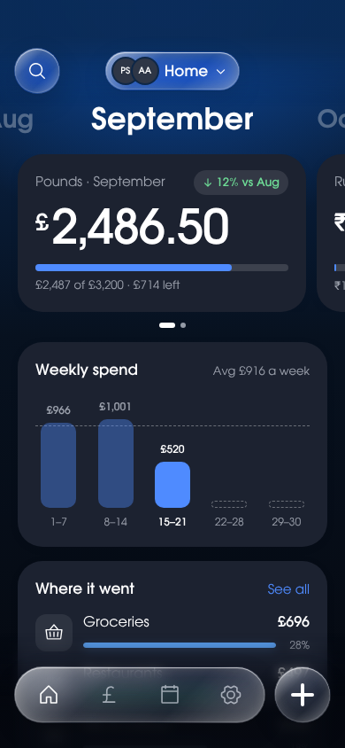
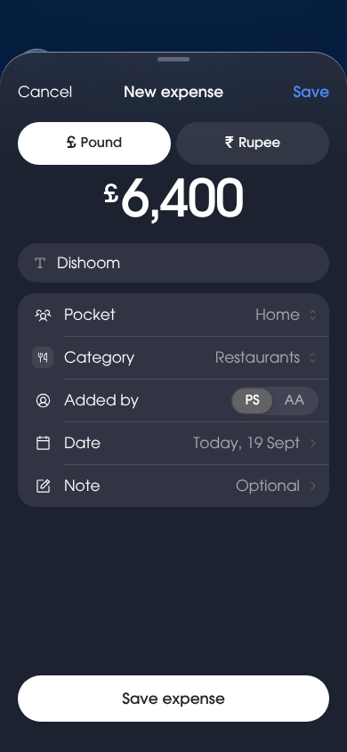
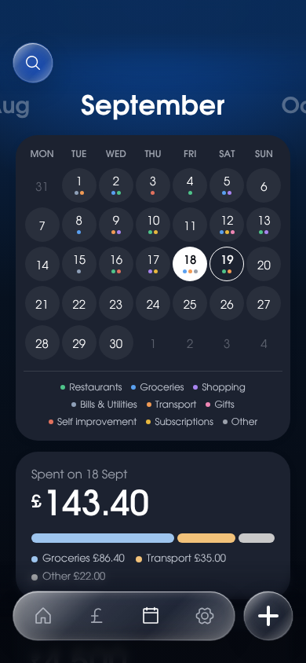

# Pockets

**Pockets** is an open-source expense tracker for you and the people you share costs with. Every account gets a private Personal Pocket. Create shared Pockets with a partner or flatmates, invite them by link, code or QR, and see who spent what. Each expense keeps its own currency, and totals are never converted or mixed. It installs on your phone as a web app, works offline, and syncs in real time. Run your own copy with a free Firebase project.

<p>
  
  
  
</p>

## What it does

- **Personal and shared Pockets.** A private Personal Pocket for every account, plus any number of shared ones. Everyone in a shared Pocket sees all its expenses and who added each.
- **Many currencies, never mixed.** Pick the currencies each Pocket uses (£, ₹, $, €, A$, C$, S$, NZ$). Totals, budgets and charts are always per currency.
- **Home at a glance.** Month totals with budget bars, weekly spend, where it went, who spent what, and recent expenses.
- **Fast entry.** Amount, category, done. Optional name, date and note.
- **Transactions and Calendar.** Search, filter by person or currency, swipe to edit or delete. Month grid with category dots.
- **Invites.** By link, 6-character code or QR code. Single use, 48 hours.
- **Private by default.** A 4-digit app PIN on each device. Firestore security rules keep each Pocket to its members.
- **Offline.** Add expenses with no signal; they sync when you're back.
- **Export.** CSV per Pocket.

## Run your own Pockets

You need Node.js 20 or later and a Google account. Firebase's free Spark plan is enough: Pockets uses Authentication, Firestore and Hosting only, with no Cloud Functions.

1. **Create a Firebase project.** Go to the [Firebase console](https://console.firebase.google.com), add a project, and skip Google Analytics if you like.
2. **Turn on sign-in.** In *Build › Authentication › Sign-in method*, enable **Google** and **Email/Password**.
3. **Create the database.** In *Build › Firestore Database*, create a database in production mode and pick a location near you.
4. **Register a web app.** In *Project settings › Your apps*, add a web app. Copy the `firebaseConfig` object it shows.
5. **Add the config.** Copy `src/firebase.config.example.ts` to `src/firebase.config.ts` and paste your values in. That file is git-ignored.
6. **Install and log in.**
   ```sh
   npm install
   npx firebase login
   npx firebase use --add      # pick your project
   ```
7. **Deploy.**
   ```sh
   npm run deploy
   ```
   This builds the app and deploys Hosting, the Firestore rules and indexes. Your Pockets is live at `https://<project-id>.web.app`.
8. **Allow your domain for Google sign-in.** `<project-id>.web.app` and `<project-id>.firebaseapp.com` are allowed already. If you add a custom domain, add it under *Authentication › Settings › Authorized domains*.

On iPhone, open the site in Safari, tap **Share › Add to Home Screen**, and Pockets opens full screen like an app.

> **Google sign-in on iPhone.** Safari blocks third-party storage, which can break the sign-in pop-up when `authDomain` is a different domain from the one serving the app. If Google sign-in fails on iOS, set `authDomain` in `src/firebase.config.ts` to the domain you serve Pockets from (for example `<project-id>.web.app`) and redeploy. Firebase Hosting serves the sign-in helper on every domain it hosts.

### Deploy from GitHub

`.github/workflows/deploy.yml` deploys on every push to `main`. Add these repository secrets (*Settings › Secrets and variables › Actions*):

| Secret | Value |
| --- | --- |
| `FIREBASE_PROJECT_ID` | Your project id. |
| `FIREBASE_WEB_CONFIG` | The web config as JSON, for example `{"apiKey":"…","authDomain":"…","projectId":"…","storageBucket":"…","messagingSenderId":"…","appId":"…"}`. |
| `FIREBASE_SERVICE_ACCOUNT` | A service account key (JSON) from *Google Cloud console › IAM › Service accounts*, with the **Firebase Admin** role (it covers Hosting, rules and indexes). |

Without the secrets the deploy job is skipped, so forks don't fail.

## Develop

Everything runs locally against the Firebase emulators; no Firebase project needed. The emulators need Java 11 or later.

```sh
npm install
npm run emulators          # Auth on :9099, Firestore on :8080
npm run seed               # optional: sample Pockets, people and expenses
npm run dev:emulators      # the app on http://localhost:5173
```

The seed creates `prernaa@example.com` and `aakash@example.com`, both with password `password123`, sharing a Pocket called Home in £ and ₹. Set any PIN the first time you open the app.

| Command | What it does |
| --- | --- |
| `npm run dev` | App against the project in `src/firebase.config.ts`. |
| `npm run typecheck` | TypeScript. |
| `npm test` | Unit tests (money, dates, invite codes, CSV, stats). |
| `npm run test:rules` | Security rules tests in the Firestore emulator. |
| `npm run build` | Production build in `dist/`. |

### How it's built

- React, TypeScript and Vite, installable as a PWA (`vite-plugin-pwa`).
- Firebase Auth (Google, email and password) and Firestore with offline persistence.
- Plain CSS with design tokens in `src/styles/tokens.css`. One typeface, [Involve](https://github.com/StefanPeev/Involve), self-hosted. Icons from [Phosphor](https://phosphoricons.com).
- Money is stored as integers in minor units (pence, paise, cents) and formatted with `Intl.NumberFormat`.

```
src/
  data/        Firestore reads and writes, types, live hooks
  state/       session, Pockets, app lock, UI state
  screens/     one file per screen
  components/  shared pieces: tab bar, sheets, keypads, rows
  lib/         money, dates, currencies, categories, icons, PIN, CSV
  styles/      tokens, base, components, screens
firestore.rules            security rules
tests/rules/               rules tests
scripts/seed-emulator.mjs  sample data for the emulators
design/                    the approved design (open Pockets.dc.html via `npx serve design`)
docs/SPEC.md               product spec
```

### Data and security

```
users/{uid}                          name, initials, email, pocketIds
pockets/{pocketId}                   name, type, ownerUid, currencies, budgets
pockets/{pocketId}/members/{uid}     name, initials, role
pockets/{pocketId}/categories/{id}   name, icon, colour, order, system
pockets/{pocketId}/expenses/{id}     currency, amountMinor, name, categoryId, byUid, date, note
invites/{code}                       pocketId, createdBy, createdAt, usedByUid
```

Only members can read or write a Pocket. Only the owner can rename it, change its currencies, remove people or delete it. Joining is a single batch that marks an invite used and adds the member; the rules check the invite is for that Pocket, unused and less than 48 hours old by the server's clock. The app PIN never leaves the device: it is hashed with PBKDF2 and kept in IndexedDB.

## Licence

Code: [MIT](LICENSE). The Involve typeface is © 2022 Involve Project Authors, under the [SIL Open Font Licence 1.1](public/fonts/OFL.txt).
